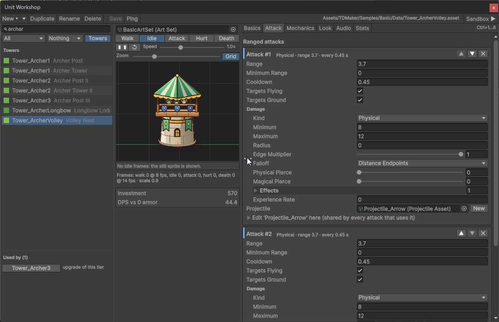
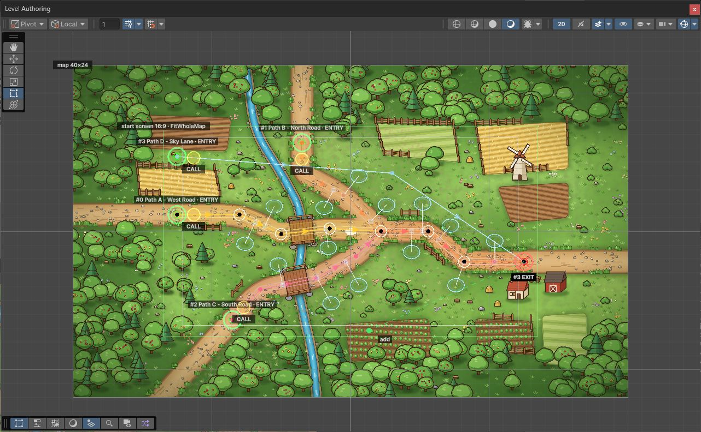
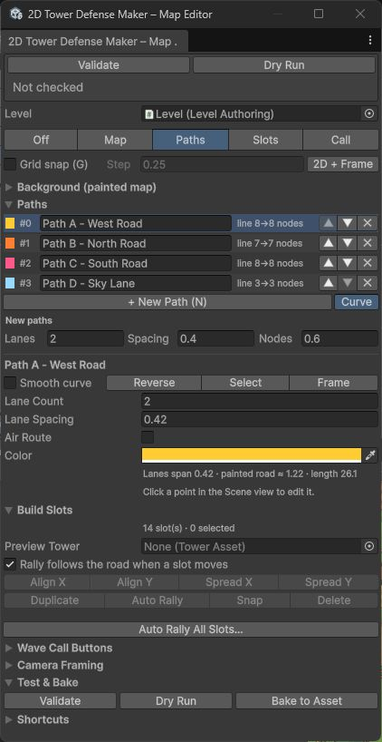

# Editor Tools

| Tool | Where |
|---|---|
| Welcome | **Tools > 2D Tower Defense Maker > Welcome** (opens by itself the first time a project loads 2D Tower Defense Maker) |
| New Level wizard | **Tools > 2D Tower Defense Maker > New Level** |
| Map Editor | **Tools > 2D Tower Defense Maker > Map Editor** (or **Open Map Editor** on Level / Path Authoring) |
| Unit Workshop | **Tools > 2D Tower Defense Maker > Unit Workshop** (or **Open in Unit Workshop** on an Enemy) |
| Path and lane editor | Select a GameObject with **Path Authoring** |
| Build slot handles | Select a GameObject with **Build Slot Authoring** |
| Wave Timeline | **Tools > 2D Tower Defense Maker > Wave Timeline** |
| Upgrade Tree | **Tools > 2D Tower Defense Maker > Upgrade Tree** |
| Project Validator | **Tools > 2D Tower Defense Maker > Validate Project** |
| Dry Run | **Tools > 2D Tower Defense Maker > Dry Run Level** |
| Sample browser | **Tools > 2D Tower Defense Maker > Samples > Browse Samples** |
| Sample generator | **Tools > 2D Tower Defense Maker > Samples > Regenerate Sample Content** |

All range ellipses drawn by the tools use the same shape as the simulation (`RangeShape`). The Y scale is taken from the open scene (level override, else the runner's value, else 0.8).

---

## Welcome

**Tools > 2D Tower Defense Maker > Welcome** starts with TextMesh Pro setup, then **Create your game**: New Level, Unit Workshop and Map Editor. **New Level** defaults to fresh assets in your own folder and works without the Samples add-on. The **Browse Samples** button opens a separate browser for the optional complete sample game and feature examples. Missing samples are not a setup failure. **Online Documentation** and **API Reference** open the guide and C# reference. **Show on startup** is stored per project; the window never opens in batch mode.

### Optional sample browser

**Tools > 2D Tower Defense Maker > Samples > Browse Samples** separates the complete **Sample Game** (title, slots, campaign, star shop and battles) from feature examples (Basic, Crossroads and Winding Pass). It also links back to New Level. Sample regeneration is available only when the add-on's editor scripts are installed and asks before resetting generated samples. These examples demonstrate choices you can replace in your own game; they are not mandatory Maker configuration.

---

## New Level wizard

**Tools > 2D Tower Defense Maker > New Level** makes a playable level in one step.

Use **Online Quick Start** in the wizard to open the first-level walkthrough in your browser.

| Input | Meaning |
|---|---|
| Level Name | Scene and asset names; fresh assets get template ids starting with the name (`mylevel_walker`, a number is added when the name is taken). |
| Folder | Default `Assets/TDMakerContent/<Name>`. Folders inside `Assets/TDMaker` (the package and its samples) are refused. |
| Background | Optional painted map (Sprite, or a Texture that is re-imported as a Sprite). The default path and slots are stretched to the map, it becomes the Level View ground art and the camera is clamped to it. |
| Starter content | **Sample kit**: the Basic sample's archer, barracks, cannon and arcane towers, its enemies, the Warden and two spells (the level refers to `Samples/Basic`). **Fresh starter assets**: new assets in `<Folder>/Data` from the Unit Workshop presets – Walker (standard enemy), Archer Tower with Archer Tower II, Barracks with Footman, and Captain (melee hero) when **Include Hero** is on. |
| Include Starter Spell | Adds a reinforcement spell to fresh starter content; enabled by default. Its soldier asset is created in the same Data folder. |
| Waves | 1–30 (default 3). Each wave is larger than the last; the waves together always send more enemies than the level has lives, so an undefended level is lost. |
| Use Sample Sounds | Fills the units' sound cues, the level music and the scene's interface sounds with the sample audio (`Samples/Audio`). Disabled by default; enable it when the sample audio is available and you want to use it. Off: every cue and track stays empty, so a level made from fresh starter assets does not depend on the Samples folder (assign your own clips later). |

It creates `<Folder>/<Name>.unity` and `<Folder>/Data/` (`<Name>_Level`, `<Name>_Waves`, `<Name>_HudTheme`, `<Name>_SpriteUnlit` and the fresh units). The scene is built by the same code as the sample scenes: camera, **Level Authoring** with one **Path Authoring** (two lanes, entrance at the left edge, exit at the right edge) and six **Build Slot Authorings** ordered from the entrance with rally points on the nearest road, and the `2D Tower Defense Maker` object (Simulation Runner, Entity View Registry, Level View, VFX Pool, Audio Cue Player, Music Player, Game Settings, Game HUD with the F1 debug overlay, Damage Numbers). Afterwards the scene is open, the Level is selected, the Map Editor is open on the **Paths** tool and the wizard lists the next steps (with buttons for the Map Editor, Unit Workshop, Wave Timeline, Validate and Dry Run).

The result has no Validator errors or warnings and the Dry Run loses it without towers and wins it fortified and on its starting gold. Headless: `NewLevelBuilder.Create(new NewLevelSettings { ... })` (it replaces the open scenes; `NewLevelBuilder.Validate` returns the first problem with the settings).

---

## Map Editor

One window for turning a painted map into a level: background, curved paths, build slots, wave-call buttons, then Validate, Dry Run and Bake. It works in the Scene view (2D) on the scene's **Level Authoring**; every edit supports Undo and marks the scene dirty. Paths are drawn by hand – the editor does not try to detect roads in the image.

### Make a level from a painted map in 5 minutes

1. **Scene.** Run **Tools > 2D Tower Defense Maker > New Level** (pick your map as the Background) – it creates the scene with the 2D Tower Defense Maker rig (Simulation Runner, Level View, camera controller, HUD), a **Level Authoring** with a Level Asset, one path and six build slots, and opens this window. Or duplicate a sample scene (for example `Samples/Basic/BasicSample.unity`) and delete or edit its paths and build slots.
2. **Background.** Open **Tools > 2D Tower Defense Maker > Map Editor** and drop your map Sprite (or Texture – it is re-imported as a Sprite) on the drop area. The map becomes the Level View's ground art, the game camera is clamped to the map rectangle, and the Scene view switches to 2D and frames it. Check the size line (`Image 1920×1080 px · 100 px/unit · world 19.2×10.8 units`).
3. **Paths.** Press **P** (Paths tool) and **N**, then click along the road **from the entrance to the exit**: a handful of clicks at bends is enough – the path is a smooth curve through your points, sampled into simulation nodes every `Node Spacing` units. Drag points to fine-tune, Shift+click on the road to insert, Ctrl+click to delete. Set **Lane Count** / **Lane Spacing** until the drawn road band (lanes plus the Level View's road padding) matches the painted road; drag the white side handles of a selected point to widen or narrow the road there. Press **N** again for the next path; **[** / **]** switch paths.
4. **Build slots.** Press **B** and click where towers may stand. Each new slot gets its rally point on the nearest point of the nearest road. Pick a **Preview Tower** to see its range ellipse at the cursor and around new slots. The ghost turns orange when a slot would overlap a road or another slot. Use **Align X/Y**, **Spread X/Y**, **Snap**, **Duplicate** and **Delete** on the selection.
5. **Wave-call buttons.** Press **C** and drag the yellow ring of each entrance to where the HUD should show its call button (Ctrl+click resets it to just ahead of the entry).
6. **Test.** **Validate** opens the Project Validator; **Dry Run** simulates the level with the scene geometry (summary in the window, full report in the Console); **Bake to Level Asset** writes the scene paths and slots into the Level Asset (Undo works on the asset too). Press Play.

### Background

| Setting | Effect |
|---|---|
| Drop area / **Map Sprite** | Sets the Level View's painted ground (Generated ground style). Textures are switched to Sprite import. |
| **Pixels Per Unit** | Re-imports the texture at a new scale; the world size follows (`pixels / PPU`). |
| **Pivot Position**, **Center On Origin** | Where the map sits in the world. |
| **Keep alignment** (on by default) | When the map is replaced by an image of another size, its pixels-per-unit changes or it is re-centred, every path point (curve controls and nodes), lane width, node spacing, build slot, rally point and wave-call offset is mapped from the old map rectangle to the new one, so everything stays on the painted roads. One Undo step reverts the geometry (the texture import setting itself is not undone). |
| **Fit camera bounds to the map** | Clamps the `TDCameraController` to the map rectangle (fixed bounds). **Fit Camera Now** does it once. |
| **Show map in Scene view**, **Opacity** | An edit-mode preview of the map (never saved into the scene, removed before Play). Lower the opacity to see your lanes over a busy painting. |
| **Lock map** | Unlock to drag the map with the **Map** tool (M) – for lining the painting up with existing geometry. |

**Recommended backgrounds.** Paint at **16:9**, **1920×1080 to 3840×2160 px**, and choose texture compression appropriate for your target build. Keep **one pixels-per-unit value per level** and decide it before drawing paths – all level coordinates (paths, slots, rally points, ranges, speeds) are **world units**, so the PPU decides how big a tower range or an enemy step is on your painting. The window shows a non-blocking hint when the image is not 16:9, is larger than 4096 px, is down-scaled by its Max Size or is imported uncompressed (with a memory estimate).

### Paths

- **Curve mode** (default for new paths, the `Smooth Curve` toggle per path): you edit control points; the path is a centripetal Catmull-Rom curve that passes through every control point and is sampled into the simulation's node list at `Node Spacing` (each span gets `round(length / spacing)` equal steps). The entry is the first control point and the exit the last. Per-point lane widths are interpolated along the curve.
- **Polyline mode**: the original point list, used as it is, with `Entry Node` / `Exit Node`. Existing paths stay polylines; switching a polyline to curve mode seeds the control points from its points (entry to exit), so the shape is kept. Switching back keeps the generated nodes.
- The path list renames (type in the row), reorders (▲▼ – waves refer to paths by **index**) and deletes paths. Clicking another path's line in the Scene view selects it.
- Every path shows its road band, all sub-lanes, direction arrows, `ENTRY` / `EXIT` markers and its wave-call button.

### Camera framing and larger maps

The **Camera Framing** section edits the level's framing (Level Asset, or a scene override on Level Authoring): **Fit Whole Map** (default – the whole map on one screen, no player pan or zoom), **Fit Height Scroll Horizontally**, **Fit Width Scroll Vertically** or **Fixed View Size**, the **Start Focus** and an optional **Intro Pan** along the first path. With **Show start screen** on, the Scene view draws the first screen of the level as a green rectangle for the chosen reference aspect (16:9 by default; 16:10, 21:9, 4:3), using the same math as the game camera – so you see what fits on screen before pressing Play. For a scrolling level, paint the map wider (or taller) than 16:9 and keep the same pixels-per-unit; see [Presentation](presentation.md) for the camera inputs.

### Shortcuts (Scene view while a Map Editor tool is active)

| Key / input | Action |
|---|---|
| **M / P / B / C** | Map, Paths, Slots, Wave Call tool |
| **Esc** | Deselect, then turn the tool off |
| **G** | Toggle grid snap (step in the window) |
| **N** | Start a new path with the next click |
| **[ / ]** | Previous / next path |
| Click | Paths: add a point at the end (or a new path's entry). Slots: place a slot (or select one) |
| **Shift+click** | Paths: insert on the road (away from it: add before the entry). Slots: add to / remove from the selection |
| **Ctrl+click** (Cmd on macOS) | Delete the point / slot under the cursor; Wave Call: reset the button |
| Drag | Move points, slots (the rally point follows the road when that option is on), rally squares, wave-call rings, lane width handles |
| **Delete**, **Ctrl+D**, **F** | Delete the selected point or slots, duplicate slots, frame the selected point |

The same list is in the window's **Shortcuts** section. With the Map Editor's Paths/Wave Call tool active, the Path Authoring inspector only draws (the window owns the handles); with the Slots tool active, the Build Slot inspector's rally handle is hidden.

Scripting: the operations behind the window are public in `MapEditing` (create paths and slots, auto rally, align, remap, bake) and the curve math in `PathGeometry` (runtime assembly).

---

## Path and lane editor

Select an object with **Path Authoring**. The Scene view shows the centre line with direction arrows, all generated sub-lanes, `ENTRY` / `EXIT` markers and (optionally) build slots with their ranges.

| Input (Scene view) | Action |
|---|---|
| Drag a point | Move it |
| **Shift+click** | Add a point at the end; on a segment, insert a point there |
| **Ctrl+click** (Cmd on macOS) | Delete the hovered point (a path keeps at least two) |
| **Delete** | Delete the selected point |
| **Ctrl+D** | Duplicate the selected point |
| **F** | Frame the selected point |
| **Esc** | Deselect |
| Drag the white side handles | Override the lane width at that point (snaps back to default when equal) |

Inspector:

- **Lanes**: `Lane Count`, `Lane Spacing`, `Entry Node`, `Exit At Last Node` / `Exit Node`.
- **Scene Editing**: `Snap` toggle and `Step` (stored in editor preferences).
- **Points** list with per-point `Lane Width`, plus **Reverse** (swap direction) and **Reset Widths**.
- **Build Slots / Ranges** toggles show every build slot, its rally point and tower ranges while you edit paths.

All edits support Undo.

## Build slot handles

Select an object with **Build Slot Authoring**:

- Drag the **Rally** handle to set the default rally point.
- Set `Preview Tower` to draw its attack range and rally radius; the inspector shows the resulting ellipse size and warns when the rally point lies outside the rally radius (the simulation would pull it back onto a lane inside the ellipse).
- **Reset Rally** and **Use Level Y Scale** (copy the scene's Y scale to the gizmo).

---

## Wave Timeline

Open with **Tools > 2D Tower Defense Maker > Wave Timeline**, from the Level or Level Authoring inspector, or by double-clicking a wave issue in the Validator. Works on a Wave Set or on the Wave Set of a Level asset. `Follow` keeps it in sync with the Project selection; path names come from the first level that uses the wave set.

**Layout**

- Left: list of waves with per-wave totals (units, total HP, gold, duration, auto delay) and **+**, duplicate, ▲ / ▼ (reorder), **−** buttons.
- Centre: one row per group (sorted by path). Each spawn entry is a bar from its start to the end of its last interval, with a tick per spawned unit, coloured by enemy.
- Right: inspector for the selected wave, group or entry (including **Add Entry**, **Duplicate**, **Delete Group**, ◀ Earlier / Later ▶, **Select Enemy Asset**, and warnings for missing enemies or invalid lanes).
- Footer: totals for the whole wave set.

**Mouse**

| Input | Action |
|---|---|
| Click a bar | Select the entry |
| Drag a bar | Change the entry's start delay |
| **Alt**+drag a bar | Change the group's start delay |
| Drag a bar's right edge | Change the interval |
| **Shift**+drag the right edge | Change the count |
| Click an empty row | Select the group |
| Double-click an empty row | Add an entry at that time |
| Mouse wheel | Scroll rows |
| **Shift**+wheel | Scroll time |
| **Ctrl/Cmd**+wheel | Zoom time around the cursor |

**Keyboard**

| Key | Action |
|---|---|
| ← / → | Nudge the selection by the snap step |
| Page Up / Page Down | Previous / next wave |
| Delete | Delete the selected entry (or group) |
| Ctrl+D | Duplicate the selected entry (or group) |
| F | Fit the wave to the view (also the **Fit** button) |
| Esc | Clear the selection |

Toolbar: `Snap` with steps 0.1 s / 0.25 s / 0.5 s / 1 s, **Fit**, **Ping**. If a level has no wave set, the window offers **Create Wave Set For …**. All edits support Undo.

Timing shown on the timeline matches the simulation: the first unit of an entry appears one interval after the entry starts, and an interval of 0 means one unit per tick.

---

## Upgrade Tree

Open with **Tools > 2D Tower Defense Maker > Upgrade Tree** with a Tower asset selected (or from the Validator). It shows the whole tree containing that tower: build tier → levels → branches.

Each node shows: name, `BUILD` / `LEVEL n` / `BRANCH`, template id (and "barracks"), **Cost**, **Invested** (cumulative cost along the path from the root), **Sell** (after wave 1, and full refund before wave 1), and **≈DPS / Range**. Cycles are highlighted. The side panel lists the selected tier's purchasable abilities with their rank costs.

Sell values use the `Refund Share` of the first Level asset whose tower trees contain the tier (the default 0.6 when no level contains it); the panel names the level used.

| Action | How |
|---|---|
| Edit a tier | Click the node; edit it in the side inspector |
| Select the asset | Double-click the node, or **Select Asset** |
| Add next level / branch | **+** on the node's right edge, or **Add Next Level** / **Add Branch**. A new tower asset is created next to its parent and linked. |
| Unlink | **Unlink From Parent** (the asset is kept) |
| Navigate | **Go To Root**, `Follow`, **Refresh** |

---

## Unit Workshop

One window for enemies, heroes, soldiers, towers, projectiles, status effects and spells: find them, make them from presets, see them move, edit them on flat tabs, read what they are worth and try them against your towers.

| Panel | What it does |
|---|---|
| **List** (left) | Every 2D Tower Defense Maker unit asset, grouped by type. Search (name, display name, id, effect family), type filter, tag-bit filter, towers on/off. Click, Ctrl+click and Shift+click select; several assets of one type are edited together (numbers show "—" when they differ). `*` marks unsaved changes. **Used by** lists the levels (buildable, hero, spell), wave sets (wave numbers and counts), towers (upgrade, barracks soldier, projectile) and other assets that refer to the active asset. |
| **Toolbar** | **New ▾** (presets, projectile, status effect, spell), **Duplicate** (gives the copy its own id), **Rename**, **Delete** (asks first and says how many references will be cleared), **Save**, **Ping**, **Sandbox ▶**. |
| **Preview** (middle) | Walk / Idle / Attack / Hurt / Death from the art set entry (same frame rates, hop and death hold as the game), speed and zoom, a 1-unit grid with the pivot cross and the ground line, the health bar at its real height and width. **Moving right / left** flips the direction; **Art faces LEFT** is the entry's `Faces Left` – the unit must look where it walks in both directions. Units without art show their generated shape; prefabs with an Animator list their clips. Projectiles fly from a tower to a target with their speed or flight time, arc, trail and impact flash; status effects show their tint and pip; spells their target ellipse. Below: quick numbers and checks. |
| **Basics** | Health, defenses, speed, gold, lives, flying, blocking (heroes: vitals and experience; towers: cost, targeting, upgrades, barracks). Projectiles, effects and spells show all their data as one flat form. Fields no tab claims appear under **Other**. |
| **Attack** | A melee card and one card per ranged attack (reorder, remove, add) with the damage block, target types and the projectile: pick one or press **New** to create it next to the unit, and edit its data in place. |
| **Mechanics** | Cards instead of nested foldouts. Traits (regeneration, melee evasion, reflection, aura, split on death with optional successor rules, return on the spot), on-melee-hit payloads (status effect, impact payload, life steal) and ordered timed actions (ranged attack, self buff, summon, area, chain, multi-target, trap, mine field, raise remains, beam, path transfer, custom action). **+ payload ▾** combines payloads in one action. Cards show computed hints: total health over all returns and time on the road, mines armed after the throw and how many lie on the road, cast plus rise time of a raise; problems (an empty placement band, a lifetime shorter than the arming, a raise without a unit) appear inside the card. Heroes and towers: a **Companions** card (unit, slots, escort or follower, refill) with mode/unit checks. Heroes: skills with ranks (points, level, passive stats, actions). Towers: purchasable abilities with ranks and **+ Mine-laying ability** (a ready two-rank mine field). |
| **Effects** | Status immunities, tag bits, the effects each hit applies (editable in place), **+ New effect**. |
| **Look** | View settings, the art set entry of this view key (created on request), frame arrays, scale, health bar placement, **Art Faces LEFT**, and the frame drop area (below). |
| **Hero** | Skill mode, respawn, move rule, growth graph (experience, health and DPS per level), growth table, **Fill growth curve**, skill rank summary. |
| **Audio** | Spawn / attack / hit / death cues with **Play** / **Stop**, VFX hooks, the launch / impact cues of the projectiles the unit fires, and the cast cue of spells that call this unit. Projectiles and spells show their own cues. |
| **Engagement** | Contact bias and row spacing, with a top view of the three blocker places around the enemy (rank 1 in front, ranks 2 and 3 below and above, pulled back by half the row spacing; ranks 4+ reuse them) for either walking direction. Soldiers and heroes are drawn against an enemy you pick. |
| **Stats** | See "Computed values" below. |
| **Sandbox** | See "Sandbox" below. |

### Bulk frame registration

Drop a sprite folder or several PNG files on the Look tab's drop area. Each file is sorted by its name: `walk`, `run`, `move`, `fly` → walk loop; `idle`, `stand`, `breath` → idle; `attack`, `atk`, `shoot`, `cast`, `slash` → attack; `hurt`, `hit`, `take hit`, `damage` → hurt; `die`, `death`, `dead` → death. The last number is the frame number (`Orc_Walk_003`, `walk (2)`, `1_ATTACK_005`, `goblinRun07`); a number right after the word is a variant (`Attack2_05`) and only the lowest variant is used. Files without an action word are reported as unsorted. The textures are set to Sprite, pivot bottom centre (the feet), no mip maps, compressed. Found sequences replace the entry's arrays; the idle sprite becomes the first idle (or walk) frame when the entry has none. The direction the art faces is never guessed: check **Art faces LEFT** in the preview.

### Presets

Standard, Fast, Armored, Magic Resistant, Healer (permanent healing aura), Splitter (splits into a smaller enemy that is created with it), Flying, Boss, Melee Hero, Ranged Hero, Barracks Soldier, Necromancer (raises weak enemies from the bodies of the fallen; the raised enemy is created with it as `_Risen`), Revenant (returns once with half its health). A preset scales the project's median enemy and soldier (or built-in defaults) by ratios inside the balance bands: gold per health ×0.5–1.8 of the standard enemy, defenses in the low / medium / strong bands, hero experience steps ×3 then ×1.35. They are starting points; tune them against your towers with the Stats and Sandbox tabs.

### Computed values

The numbers follow the simulation's damage rules exactly for single-target hits without status effects: a hit rolls `ceil(lerp(min, max))`, an enemy keeps `floor(hit × (1 − reduction))` (soldiers: `hit − floor(hit × reduction)`), and the reduction is the matching defense minus pierce (explosion and electric use half the armor). Expected values average every integer roll.

- **Enemy:** effective health and hits of 10 for every damage kind; gold per 100 HP and per 100 effective HP; bounty density against the project's median enemy; for every tower tier in the project: hits of its strongest channel, seconds with every channel (and up to Blocker Capacity barracks soldiers), DPS and gold per 100 invested.
- **Hero:** per level experience, step ratio, health, armor, DPS, effective health and skill points; a level-1 duel against every enemy.
- **Soldier:** effective health, DPS against 0 / 50 / 90 % armor, a duel against every enemy.
- **Tower:** investment, DPS by defense, time to kill every enemy.
- **Checks:** defenses above 0.9, full reduction, zero speed, flying-but-blockable, bounty density outside ×0.5–1.8, experience steps outside ×1.1–1.6 (the first step up to ×3.5), units that cannot block, enemies that split into themselves.

### Sandbox

A straight lane, the towers you list beside it (any tier, unlimited gold) and a wave of the unit (`Count`, `Spawn interval`). Heroes and soldiers (a barracks of three) face an opponent enemy instead. **Run headless** plays it with a fixed seed and reports the outcome, spawned / killed / leaked, lives lost, kill time from spawn (average, fastest, slowest), damage taken by enemies and by soldiers or heroes, gold, damage / hits / kills per source and the final state hash – the same inputs always give the same table. **Buy tower abilities** buys every rank of the listed towers' abilities before the wave (mine fields only act once bought). When they happen, mines thrown and traps triggered, companions arrived (and refills), falls and finished rises, and bodies reserved and raised are listed too; a fall of a returning unit is not counted as a kill. **Play in temporary scene** opens an unsaved scene with the lane, the towers, views (with the Workshop's art set) and the debug HUD and enters Play mode; stop Play mode and discard the scene when done.

### Shortcuts

Ctrl+N new · Ctrl+D duplicate · F2 rename · Delete delete · Ctrl+S save · Ctrl+F search · ↑ / ↓ move in the list (Shift extends) · Ctrl+1…9 tabs · Space play / pause the preview · M flip the walking direction · Numpad 1–5 preview action.

### Make an enemy in 5 minutes

1. **Create.** Open **Tools > 2D Tower Defense Maker > Unit Workshop**, select an asset in the folder where the new one should go, then **New ▾ > Enemy > Armored** (or any preset). The asset gets an id from its name and numbers scaled from your project's enemies. Press **F2** to rename it.
2. **Numbers.** On **Basics**, adjust health, armor and speed. Watch the quick numbers under the preview and the **Stats** tab: the tower table tells you how long each of your tower tiers needs to kill it; orange rows are slow or cannot hit.
3. **Look.** On **Look**, pick your art set (or **New**), press **Create entry**, then drop the folder with the unit's PNGs on the drop area. Play Walk / Attack / Death in the preview, press **M** to flip the direction and tick **Art faces LEFT** if the unit walks backwards. Set the scale and the health bar height.
4. **Special.** On **Mechanics**, **+ Add mechanic ▾ > Trait > Aura** (or a timed action) and fill in the card. On **Audio**, assign the hit and death cues and press **Play**.
5. **Try it.** On **Sandbox**, **Pick ▾** two or three tower tiers, set the count and press **Run headless**: killed / leaked and the kill times show whether the enemy fits the wave you have in mind; **Play in temporary scene** shows it in motion. Then add it to a wave in the **Wave Timeline** and press **Ctrl+S**.

---

## Inspectors with computed stats

Enemy, Tower and other template inspectors group fields in foldouts and show any extra fields under "Other". The identity header shows the resolved id and warns about duplicate ids.

| Inspector | Computed |
|---|---|
| **Enemy** | Effective HP (hits needed) against each damage kind; warnings for zero speed and full physical+magical reduction. Mechanics fields (`Tags`, `Behavior`, `Aura`) have their own group |
| **Tower** | Cumulative investment, sell value (after/before wave 1) and the refund share used (from the tower's level), range ellipse size at the scene's Y scale, garrison size and HP, DPS table for ranged attacks and for soldiers against several defense values; warnings for towers that do nothing and soldiers that cannot block |
| **Level / Level Authoring** | **Validate Bake**, **Wave Timeline**, **Validate Project**, **Write Scene Geometry To Level Asset** |

DPS and effective-HP values are approximations (averages; no rounding, status effects or incoming multipliers), marked with "≈".

---

## Project Validator

**Tools > 2D Tower Defense Maker > Validate Project** scans every 2D Tower Defense Maker asset and the open scenes.

- Filter by Errors / Warnings / Info; click to select the asset, double-click (or Enter) to open the right tool (Wave Timeline for waves, Upgrade Tree for upgrade issues).
- **F5** re-runs; arrow keys move the selection.
- Checks include: missing references; duplicate template ids and projectile view keys; enemies with zero speed or full immunity; towers that do nothing, list themselves, have empty or duplicate upgrade slots, upgrade cycles, or are not buildable in any level; soldiers that cannot block; zero rally radius; attacks with zero range or no target types; waves without groups or enemies; entries without an enemy; path/lane indices that do not exist; invalid paths (fewer than two points, entry not before exit, coincident points, overlapping lanes); levels without waves, towers, paths or slots; failed bakes; rally points outside the rally radius; mechanics: enabled auras or pulses without a payload, auras that do not follow their unit, chains that cannot jump, multi-target health budgets with area damage.

Headless: `TDMaker.Editor.ValidatorWindow.RunBatch` logs every issue (for `-executeMethod`).

---

## Dry Run

**Tools > 2D Tower Defense Maker > Dry Run Level** runs the level headlessly and logs a report. It uses the selected Level asset, or the first Level Authoring in the open scene.

Three passes:

- **Undefended**: no towers, every wave called as early as possible – shows the total threat (a sound level is lost here).
- **Fortified**: unlimited gold; builds and upgrades towers on every slot (branch choice rotates by slot so each branch is also built near the entry; the report lists the final tiers reached), buys every ability, spawns heroes, moves them, spends skill points and casts ready spells.
- **Budget**: the level's real starting gold, spent by a simple greedy player – start the first wave after three seconds, let later waves arrive on their timers, build the next empty slot (slots in list order, buildable towers cycled per slot) until half the slots hold a tower, then buy the cheapest of the next build (counted double), upgrades and ability ranks; hero and spells assist as in the fortified pass. The line adds lives left, gold left and spent, final tiers and the lives at the start of every wave. A budget-pass victory provides one reproducible winning strategy; use playtesting to assess how clear and forgiving that strategy is for your players. Order your build slots from most to least important – the budget pass builds them in that order.

The report lists the outcome and time, waves, enemies (killed, lives lost), towers built and upgraded, soldiers, shots, damage, abilities, spells, summons, effects, a mechanics line (chains and links, multi-target hits, region pulses, shields raised and damage absorbed, impact payloads, displacements and knockback payloads), an advanced line (traps placed/armed/triggered and how they ended, beams with pulses, budget and end reasons, path transfers, reflections, life steal), ballistic accuracy per source (fired, landed, damaging, target already gone before landing, landed beside a live target with the average miss distance), heroes, any remaining enemies, and rejected commands by type. Release-mechanic counters list thrown mines, companions, temporary falls/finished rises and reserved/raised bodies; a temporary fall is not a final kill. Rejected commands point to content problems (for example a barracks whose rally point cannot reach a lane).

The range Y scale is the level's override when set, otherwise the open scene's `Simulation Runner` value (0.8 when there is none). Headless: `-executeMethod TDMaker.Editor.LevelDryRun.RunSample` runs every sample level (Basic, Crossroads, Winding Pass); add `-dryRunLevel <asset path>` for one level asset. From code: `LevelDryRun.Report(levelAsset, out PassResult[] results)` returns the report and each pass' phase, stars, lives, time and waves.

---

## Permanent upgrade shop

**Tools > 2D Tower Defense Maker > Upgrade Shop** edits ordered track/rank columns, a back-loaded star-price curve and stat/mechanic/template-swap effects, with validation and before/after stat previews. Link the shop on the Campaign asset; the world map then offers **Upgrades**. See [Campaigns, Progress and Saves](campaign.md#the-star-upgrade-shop) for purchases, Undo Changes, Reset All, save integration and battle snapshots.

## Sample generator

**Tools > 2D Tower Defense Maker > Samples > Regenerate Sample Content** (re)creates every generated sample: `Samples/Basic` (data assets and `BasicSample.unity`), `Samples/Crossroads` and `Samples/WindingPass` (their own data plus references to the Basic towers, enemies, hero and spells) and `Samples/Demo/DemoSample.unity` (title, save slots, world map and result flow over the three levels, with the sample campaign `Samples/Demo/Data/SampleCampaign.asset` and its map image `Samples/Demo/Art/world_map.png`; the scripts in `Samples/Demo/Scripts` are not generated). Re-running updates generated assets in place, including customized sample data. Keep your own game content outside the package folder. Headless: `TDMaker.Editor.SampleContentGenerator.Generate()`.

---

## Sample screenshot

**Tools > 2D Tower Defense Maker > Capture Sample Screenshot** plays the Basic sample with a scripted run and saves a PNG of the camera and HUD. Batch: `-batchmode -executeMethod TDMaker.Editor.SampleScreenshot.Capture` (without `-quit` and without `-nographics`). Details and options: [Sample screenshots](presentation.md#sample-screenshots).

## Creating and checking content

- New Unit Workshop assets clear the active list filters and are selected and scrolled into view. When a user-created level is open, its Data folder is the first save-folder suggestion; packaged sample folders are not the default.
- A Wave Timeline group's **+** opens an enemy picker before adding the entry. Count and Interval are copied from the previous entry, and the operation supports Undo. Double-clicking an empty group row uses the existing copy-entry workflow.
- Map Editor keeps Validate/Dry Run controls and their latest summaries at the top of the window. Click the error/warning summary to open the Validator. The separate all-slot **Auto Rally** action asks for confirmation and supports a single Undo step.
- **Sample kit** refers to existing sample units. Disabling **Use Sample Sounds** does not remove audio references already stored on those shared units. For content independent of Samples, choose **Fresh starter assets** and leave sample sounds off.

## Authoring screenshots

These are actual editor captures. The Unit Workshop and Map Editor use their standard window sizes.

### Unit Workshop: attacks and preview

### Paths and build slots

