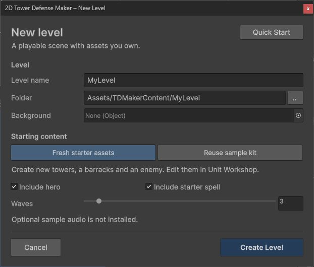

# Quick Start

Start with the **Maker** package to create your own game. The separate **Samples** add-on provides a reference game and feature examples; it is optional. See [Maker and Samples](package-layout.md) for installation and ownership.

## Build your first level (about 5 minutes)

1. Open **Tools > 2D Tower Defense Maker > New Level** (also on the **Welcome** window, **Tools > 2D Tower Defense Maker > Welcome**).
2. Enter a **Level Name**. The folder follows it (`Assets/TDMakerContent/<Name>`); change it if you like, but not to a folder inside `Assets/TDMaker` (the package).
3. Optional: drop your painted map on **Background**. The default road and build slots are stretched over it and the camera is framed on it.
4. Pick the **Starter content**:
   - **Fresh starter assets** – a new enemy (Walker), an archer tower with a level 2 upgrade, a barracks with its soldier and, with **Include Hero**, a hero, all in the level's `Data` folder. **Include Starter Spell** is on by default and adds Reinforcements using the Footman in the same folder. **Use Sample Sounds** is off by default; enable it only when you want references to `Samples/Audio`.
   - **Sample kit** – the Basic sample's towers, enemies, hero and spells (the level then depends on `Samples/Basic`).
5. Set the number of **Waves** (default 3) and press **Create Level**.

You get `<Folder>/<Name>.unity` (open), `<Folder>/Data/` with the Level asset, the Wave Set and the units, and the **Map Editor** open on the **Paths** tool. Then:

1. **Road.** In the Scene view drag the road points where the road should run (Shift+click on the road inserts a point, Ctrl+click deletes). Points run from the entrance (ENTRY) to the exit (EXIT). See [Editor Tools](editor-tools.md#map-editor).
2. **Build slots.** Press **B** and drag the six pads beside the road, or click to add more. Rally points snap to the nearest road.
3. **Units and waves.** Tune the towers and the enemy in the **Unit Workshop** (Tools > 2D Tower Defense Maker > Unit Workshop) and the waves in the **Wave Timeline**.
4. **Check.** **Validate** and **Dry Run** in the Map Editor (or Tools > 2D Tower Defense Maker > Validate Project / Dry Run Level). A sound level is lost without towers and won with a defense.
5. **Spells.** Edit the starter spell in Unit Workshop, or create a Spell asset and add it to the Level asset's **Spells** list.
6. **Play.** Build on an empty pad, then click the tower artwork or pad to upgrade it. Start the battle with the entrance skull button labeled **Start Wave**.

## Optional: play the Basic sample (1 minute)

Install the optional Samples add-on after the Maker package, then open **Tools > 2D Tower Defense Maker > Samples > Browse Samples**.

1. Open `Assets/TDMaker/Samples/Basic/BasicSample.unity`.
   - If the scene or its `Data` folder is missing, run **Tools > 2D Tower Defense Maker > Samples > Regenerate Sample Content**. It (re)creates all sample assets and the scene in place.
2. If prompted, import **TextMesh Pro Essential Resources** (or use **Tools > 2D Tower Defense Maker > Import TMP Essential Resources**), then press **Play**.

The sample contains two multi-lane paths, five waves, six wave enemy types (including a shielding healer, a Revenant that returns once and a Gravecaller that raises weak Husks), four tower families (archer, cannon, arcane, garrison/barracks) with branching final tiers and purchasable abilities, the Warden with a Hound companion, two spells and five status effects. Volley Nest can buy Barbed Mines. The scenes use original vector maps, sprites and HUD art, with generated primitives as fallbacks.

### More samples

| Scene | What it shows |
|---|---|
| `Samples/Crossroads/CrossroadsSample.unity` | Three entrances whose roads merge before the gate, flying Gliders on a separate air route (dotted line; barracks cannot block them, cannons cannot hit them), a tough Marauder for the barracks, and two heroes – the Warden (skills unlock automatically) and the ranged Ranger (both sample heroes unlock skills automatically). |
| `Samples/WindingPass/WindingPassSample.unity` | One long serpentine road, Ironclads (high armor) and Runeguards (high magic resist) and a Bulwark boss; the Mortar family (minimum range, branches into armor-shredding Siege Mortar or slowing Tar Mortar, each with abilities) and a third spell, Hex Circle, that lowers both resistances. |
| `Samples/Demo/DemoSample.unity` | The playable sample flow: title screen, three save slots (delete with confirmation), the campaign world map (each win opens the next level and keeps the best stars), the three levels, pause menu (Resume / Restart / World Map) and result screen (Restart / World Map). Every action has an on-screen button. The world map also opens the permanent star-upgrade shop. See [Campaign](campaign.md). |

The three levels share gameplay assets and use separate original vector maps. Use Dry Run to compare undefended, fortified and budget-limited defenses, then play the level to check its pacing and controls.

### Default controls (PC)

| Input | Action |
|---|---|
| Left-click an empty build slot | Open the build menu; one click on an item builds it |
| Left-click a tower | Tower menu: upgrade / branch, buy ability ranks, target priority, sell, set rally (barracks) – each a single click |
| Entrance **skull button** | Before wave 1, the button shows **Start Wave**. Call later waves early for a bonus, or let the countdown ring finish to start them automatically. |
| **II / 1x / 2x / 3x** | Pause and game speed |
| **H**, click a hero or its portrait | Select a hero, then **left-click** a point to move it (any battlefield click while the hero is selected is a move) |
| **1–9** or spell buttons | Aim a spell; left-click a point to cast (empty ground included), right-click or **Esc** to cancel |
| **Esc** / right-click | Cancel every selection and aim (Esc with nothing selected pauses; right-click with nothing selected does nothing) |
| **Space** / **P**, **N**, **F1** | Pause, call the next wave, IMGUI debug overlay |
| Mouse wheel, middle drag, WASD | Zoom and pan – only in levels whose Camera Framing scrolls (the samples show the whole map; see `Game Settings`) |

The HUD is the TextMesh Pro/uGUI `Game HUD`, styled by `PaintedHudTheme`; see [Presentation](presentation.md) to restyle or replace it.

## Under the hood: a level asset by asset

The wizard only creates ordinary assets and components; this is the same level made by hand, useful when you want to know what each part does or build a scene layout of your own.

Create a folder for your content, for example `Assets/MyGame/`. All assets below are created with **right-click in the Project window > Create > 2D Tower Defense Maker > …** (also available from **Assets > Create > 2D Tower Defense Maker**).

### Step 1 – Enemy

1. **Create > 2D Tower Defense Maker > Enemy**, name it `Enemy_Walker`.
2. Set `Health` (e.g. 40), `Speed` (e.g. 1.5), `Gold` (bounty, e.g. 5), `Life Cost` (1).
3. Leave `Melee` enabled if barracks soldiers should take damage when they block it.

The inspector shows effective HP against different defense values.

### Step 2 – Tower

1. (Optional) **Create > 2D Tower Defense Maker > Projectile**, name it `Projectile_Arrow`, `Kind = Homing`, `Speed = 12`. Without a projectile an attack is an instant hit.
2. **Create > 2D Tower Defense Maker > Tower**, name it `Tower_Archer`.
3. Set `Cost` (e.g. 70). Under ranged attacks add one entry: `Range` 3, `Cooldown` 0.8, damage `Physical` 4–7, `Projectile = Projectile_Arrow`.
4. Optional: create a second tower asset, then add it to the first tower's `Upgrades` list – or open **Tools > 2D Tower Defense Maker > Upgrade Tree** with the tower selected and press **Add Next Level**.

For a barracks, create a **Soldier** asset and assign it to the tower's `Soldier` field.

### Step 3 – Waves

1. **Create > 2D Tower Defense Maker > Wave Set**, name it `Waves_Level1`.
2. Select it and open **Tools > 2D Tower Defense Maker > Wave Timeline**.
3. Press **+** to add a wave. Add a group (path 0), then an entry: `Enemy = Enemy_Walker`, `Count` 8, `Interval` 1.2.
4. Drag bars on the timeline to adjust delays; drag a bar's right edge to change the interval.

### Step 4 – Level asset

1. **Create > 2D Tower Defense Maker > Level**, name it `Level1`.
2. Assign `Waves = Waves_Level1`, add `Tower_Archer` to `Available Towers`, set `Starting Gold` (e.g. 200) and `Starting Lives` (e.g. 20).

Upgrade tiers, soldiers and projectiles referenced by the available towers are collected automatically.

### Step 5 – Scene geometry

1. Create a new scene. Make the **Main Camera** orthographic (size around 6–7) and keep it tagged `MainCamera`.
2. Create an empty GameObject `Level` and add **Add Component > 2D Tower Defense Maker > Level Authoring**. Assign `Level = Level1`.
3. Create a child GameObject `Path A` with **2D Tower Defense Maker > Path Authoring**.
   - In the Scene view, **Shift+click** to add points (Shift+click on a segment inserts), drag points to move them, **Ctrl+click** deletes.
   - Set `Lane Count` (e.g. 2) and `Lane Spacing`. Points run from entry (green, "ENTRY") to exit (red, "EXIT").
4. Create a few child GameObjects with **2D Tower Defense Maker > Build Slot Authoring** next to the path. Drag the **Rally** handle onto the road (used by barracks).
   - Assign a `Preview Tower` to see its range ellipse around the slot.

`Level Authoring` collects child paths and slots in hierarchy order when its lists are empty. Wave groups refer to paths by index (first path = 0).

### Step 6 – Runtime objects

Create an empty GameObject `2D Tower Defense Maker` and add:

| Component (Add Component > 2D Tower Defense Maker > …) | Setup |
|---|---|
| **Simulation Runner** | Assign `Scene Level` = the `Level` object. |
| **Entity View Registry** | Nothing required; it finds the runner. |
| **Level View** | Nothing required; draws a placeholder ground, path ribbons and slot pads. |
| **Game HUD** | Nothing required; uses `Camera.main` unless a camera is assigned. Optionally assign a `HUD Theme`. |
| **Damage Numbers**, **VFX Pool**, **Audio Cue Player**, **Game Settings** | Optional feedback and settings ([Presentation](presentation.md)). |

Add **Camera Controller** to the camera to fit the level on start.

If the Entity View Registry has no `Sprite Material`, an unlit sprite material is created at runtime for the placeholder sprites.

### Step 7 – Check and play

1. Select the `Level` object and press **Validate Bake** in the Level Authoring inspector, or run **Tools > 2D Tower Defense Maker > Validate Project**.
2. Optional: **Tools > 2D Tower Defense Maker > Dry Run Level** simulates the level headlessly and logs a report.
3. Press **Play**, build towers, and press **Start Wave**.

## Next steps

- Start screen with samples, tools and documents: **Tools > 2D Tower Defense Maker > Welcome**
- Field-by-field reference: [Authoring Reference](authoring.md)
- Tool reference: [Editor Tools](editor-tools.md)
- Built-in mechanics: [Mechanic Library](mechanics.md); HUD and feedback: [Presentation](presentation.md)
- Put levels on a world map with saved progress and a permanent star-upgrade shop: [Campaigns, Progress and Saves](campaign.md) (**Create > 2D Tower Defense Maker > Campaign**, **Create > 2D Tower Defense Maker > Upgrade Shop**)
- Rules of the simulation: [Concepts](concepts.md)

## Sample tips and editor workflow

The complete packaged sample flow is `Assets/TDMaker/Samples/Demo/DemoSample.unity`.

- Select English or Korean on the sample title screen. The choice is saved in PlayerPrefs, independently of campaign slots. A build uses the saved language when one exists, otherwise the Inspector language.
- **TD Game Settings > Ignore Saved Language In Editor** is on by default so you can test `Language = ko` directly in Play mode. Disable it only when you want to test saved-language loading. Use the Korean table together with the sample theme's Noto Sans KR fallback.
- Twin Roads, Crossroads and Winding Pass start with 1,200, 1,300 and 1,400 gold respectively, and each starts with 20 lives. Build a defense before calling wave 1; leaving the map undefended still loses the battle.
- In Twin Roads, divide archers and arcane towers between the upper and lower roads and use barracks to hold enemies. In Crossroads, defend the merged roads and shared exit, with archers covering the flying route. In Winding Pass, mix arcane towers and mortars on inside bends where they cover several road sections, and buy time with barracks. Tier II upgrades are available before wave 1; heroes and spells are also available.
- Creating a Unit Workshop asset clears search, type and tag filters, refreshes the list and scrolls to the selected row. The save dialog prefers the current user level's Data folder; otherwise it suggests the last user folder or `Assets/TDMakerContent/Units`.
- A Wave Timeline group's **+** opens an enemy picker. The new entry copies the preceding entry's Count and Interval, so check both values. Double-clicking a group row copies its preceding entry instead.
- Map Editor results remain above the scroll view. Click the error/warning summary for the complete list. **Auto Rally** for all slots asks for confirmation and can be undone in one step.

## New Level window

The wizard writes independent content into your chosen folder. Samples are optional.
