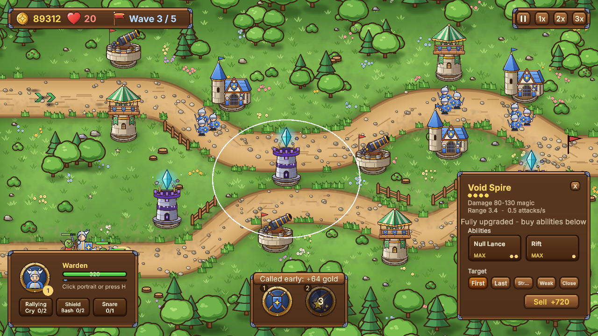
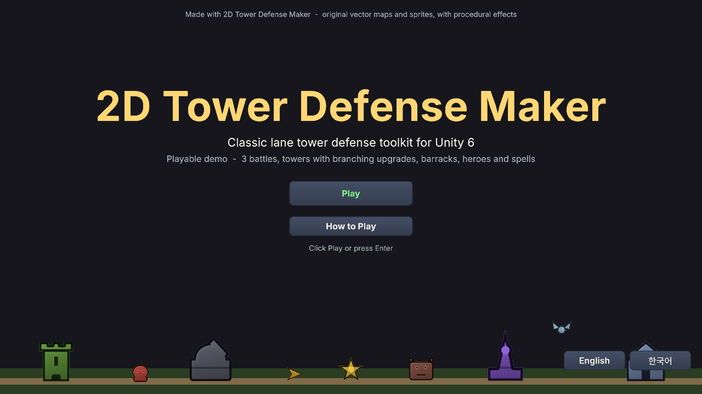
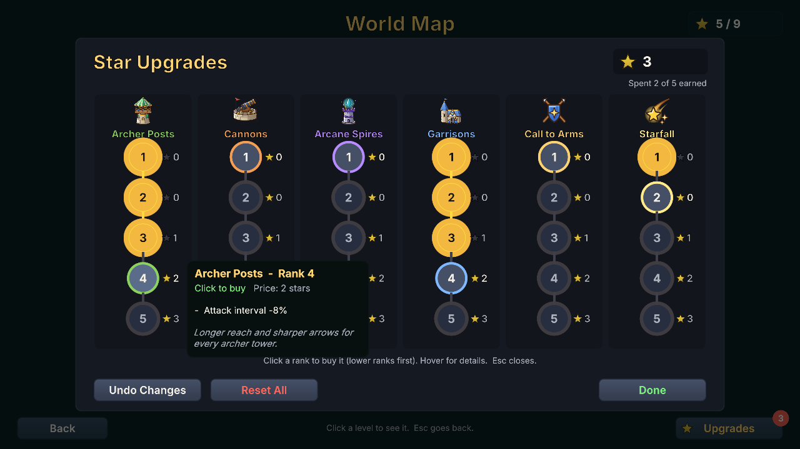

# Sample gallery

The package includes original vector artwork and four playable sample scenes. Open them from **Tools > 2D Tower Defense Maker > Welcome**. Import **TMP Essential Resources** once before playing. These images show the included package samples.

## Battle HUD

Build towers on the marked slots, upgrade them into branches, command the hero and use spells. The sample HUD uses Inter and separate padded text regions for button titles and prices. See [Presentation](presentation.md) to replace the theme, fonts and artwork.

## Title and campaign flow

Open `Assets/TDMaker/Samples/Demo/DemoSample.unity` for the title, save slots, campaign map and three battles. The sample is included in the package. See [Quick start](quick-start.md) and [Campaigns](campaign.md).

## Permanent upgrades

Spend campaign stars on ordered upgrade tracks, inspect each rank and undo or reset purchases. Configure the content through the upgrade shop assets. See [Campaigns and upgrades](campaign.md).
